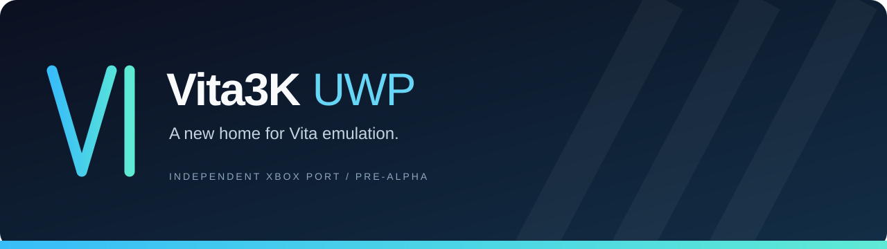

  
  
  
  

<b>An independent, experimental Vita3K port targeting Xbox Series X|S through UWP.</b> Native console foundations. Open development. Built on the work of the Vita3K community.

<a href="docs/BUILDING.md">Build</a> · <a href="docs/INSTALL.md">Install the shell</a> · <a href="docs/ROADMAP.md">Roadmap</a> · <a href="docs/RENDERERS.md">Renderers</a> · <a href="docs/UPSTREAM.md">Upstream research</a> · <a href="CONTRIBUTING.md">Contribute</a>

## Where things stand

**This is a catalog frontend and port foundation, not a playable emulator yet.** The repository contains a small native C++/CX UWP development shell and a GitHub Actions pipeline that builds an x64 APPX. The integration branch links and executes Vita3K's original bitmap memory allocator, plus a native D3D12 graphics host; the full Vita3K CPU, kernel, firmware services, and GXM renderer are not linked. There are no supported games, performance claims, or implemented emulation renderers in this port today.

| Area | Current status |
| --- | --- |
| UWP application and packaging | Signed x64 APPX with native D3D12 and real upstream memory allocator on `core-integration` |
| Xbox Series X\|S | Primary target; hardware installation and launch need testing |
| Vita3K core | Upstream bitmap allocator imported and linked; Dynarmic, kernel and full boot pending |
| D3D12 | Native device, flip swap chain, GPU clear and BGRA framebuffer upload; Vita GXM draw backend not implemented |
| Vulkan / OpenGL | Existing upstream backends; Xbox feasibility research pending |
| Game compatibility | Not available; upstream compatibility does not describe this port |
| UI, controls, storage, audio | **Streaming-style Discover/Library/Settings UI**, five themes, four generated menu soundtracks plus custom audio, saved storage/firmware paths, game metadata and custom/SteamGridDB artwork; Xbox UI validation pending |

## Development builds

Open **[Actions → UWP development package](https://github.com/oledz-i/Vita3K-UWP/actions/workflows/uwp-package.yml)** and choose a successful run. Download `Vita3K-UWP-core-d3d12-x64-<run number>` from a successful `core-integration` run (or the separately named shell artifact from `main`). GitHub may require sign-in. Builds run on pushes to `main`, pull requests, and manual dispatch.

The artifact contains a development-signed **APPX**, any generated runtime dependencies, a public test certificate, source-commit metadata, a SHA-256 checksum, and installation instructions. Artifacts expire after 14 days. No stable release is available. The workflow does not publish releases automatically.

Read the **[installation guide](docs/INSTALL.md)** before deploying. These packages are not playable Vita emulators yet. The integration build includes the full streaming-style **catalog frontend**, music and artwork options, Vita3K allocator tests and the D3D12 presentation test. See [frontend guide](docs/UI.md) to navigate the Xbox controls and report real console behavior. APPX is the initial Xbox packaging format; an MSIX/desktop packaging target can be added separately if needed.

## Frontend and artwork

The integration branch includes five visual themes, four original generated looping music tracks plus custom audio, a game catalog and local metadata reader for extracted Vita titles. SteamGridDB support requires the user's own API key and exact-title match; **automatic correct art for every title cannot be promised**. See [frontend documentation](docs/UI.md). Upstream CPU/kernel, installation and GXM rendering remain incomplete.

## Graphics direction

The goal is a dedicated **D3D12** backend for Xbox and retention of **Vulkan** and **OpenGL** where the host supports them. Upstream's renderer is not a drop-in Xbox component: Xbox exposes DirectX, and a loader DLL alone cannot provide a native Vulkan/OpenGL driver. Translation layers are a separate research task with capability, performance and UWP compatibility requirements.

See the [renderer matrix and implementation plan](docs/RENDERERS.md). The native D3D12 device, clear and CPU BGRA upload paths are graphics plumbing, not an implementation of the Vita GXM command/draw backend.

## Building and helping

The shell uses Visual Studio 2022, C++ UWP tools, and Windows SDK 10.0.22621.0. The hosted workflow uses `windows-2022`; you do not need to register a self-hosted runner or provide signing secrets. See [BUILDING.md](docs/BUILDING.md) for the local command and [CONTRIBUTING.md](CONTRIBUTING.md) for scope and issue reporting.

Useful first contributions include reproducible Xbox launch reports, UWP dependency audits, JIT/memory feasibility tests, and D3D12 capability investigations. Please report port issues **in this repository**, not to upstream Vita3K.

## Credits and licensing

The planned emulation foundation is **[Vita3K](https://github.com/Vita3K/Vita3K)**. Full credit belongs to its developers and dependency authors for their existing emulator. Our reviewed upstream revision and source map are in [UPSTREAM.md](docs/UPSTREAM.md).

New original code here is GPL-2.0-or-later; upstream and dependencies retain their own licenses and notices. See [COPYING.txt](COPYING.txt) and [NOTICE.md](NOTICE.md). No games, firmware, keys, or proprietary SDK files are included.

This is an independent community project, not an official Vita3K release and not affiliated with or endorsed by Sony or Microsoft. PlayStation and Xbox names belong to their respective owners.
