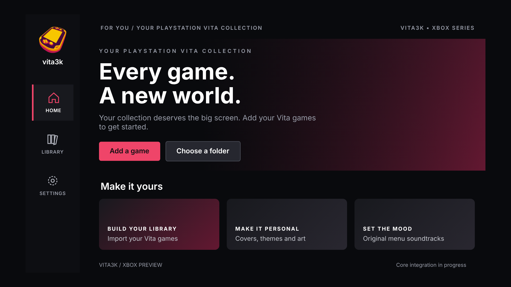
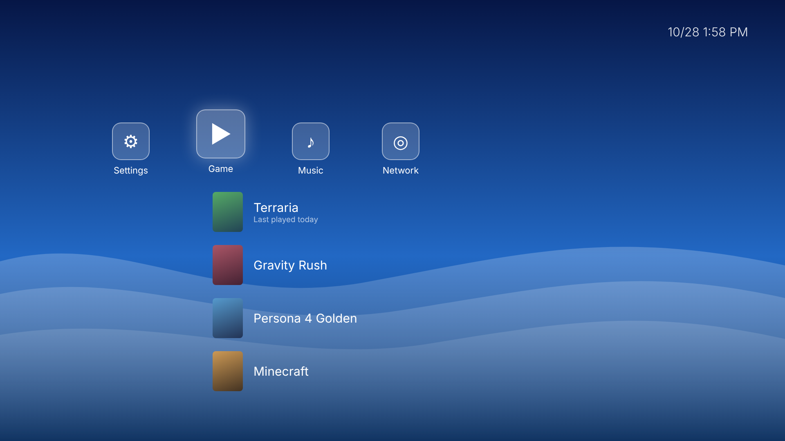
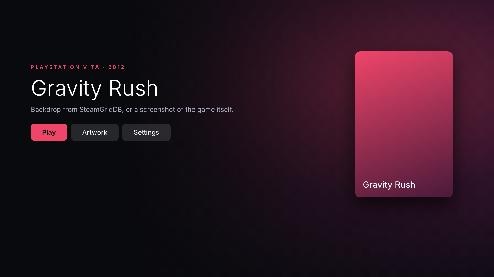
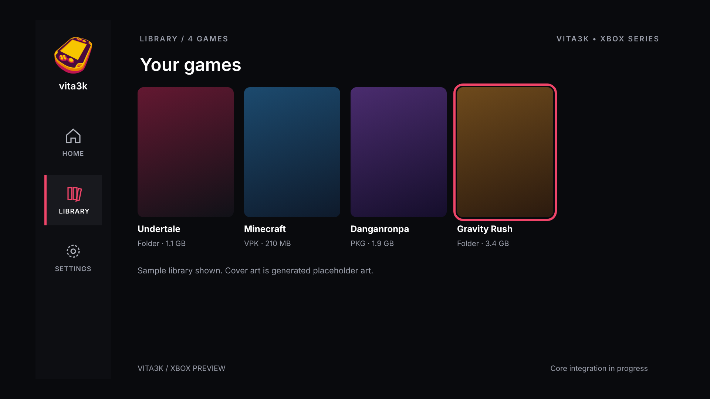
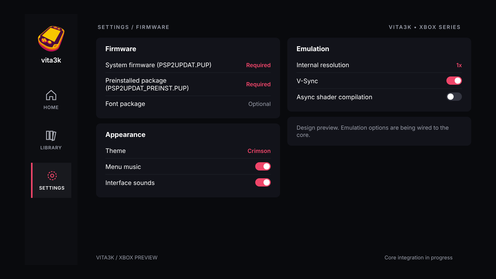

  
  
  

<b>PS Vita games on your Xbox Series X|S.</b> A port of the Vita3K emulator with a frontend built for the couch.

<a href="docs/INSTALL.md">Install</a> · <a href="docs/COMPATIBILITY.md">Compatibility</a> · <a href="docs/UI.md">The frontend</a> · <a href="docs/ROADMAP.md">Roadmap</a> · <a href="CONTRIBUTING.md">Contribute</a>

<table>
<tr>
<td width="50%"></td>
<td width="50%"></td>
</tr>
<tr>
<td width="50%"></td>
<td width="50%"></td>
</tr>
</table>

Previews of the frontend. Game names and art are placeholders.

## What this is

Vita3K is the PS Vita emulator for PC and Android. This project brings it to Xbox. The full emulator core runs as a UWP app in Xbox Developer Mode, wrapped in a frontend made for a controller and a TV.

It's an **alpha**. Plenty of games boot and play, some play well, and some don't work yet. Each update moves things forward, and every log you send helps.

## What works

- **Real games, two renderers.** Vulkan (through Mesa's Dozen) and OpenGL (through Mesa), both running on the Xbox's Direct3D 12. Some games prefer one over the other, so you can switch.
- **Games known to play:** Terraria (a steady 60 fps), Undertale, Danganronpa: Trigger Happy Havoc and Ultra Despair Girls. Gravity Rush, Persona 4 Golden and Minecraft: PS Vita Edition run, with some rough edges. Details per game are on the [compatibility page](docs/COMPATIBILITY.md).
- **Your games, your way.** VPKs, ZIPs, PKGs with their licenses, or plain game folders, from internal storage or a USB drive. Updates and DLC install from a folder you point the app at.
- **Firmware in one go.** Pick your firmware files under whatever names they have. The app works out which is which and installs them.
- **Saves, trophies and the system dialogs**: save screens, messages and the on-screen keyboard.

## The extras

- **Two home screens.** A cinematic one with big artwork, or a **PS3-style XMB** with eleven colours: pick one you like, or let it follow the month the way the PS3 did.
- **Art from SteamGridDB.** Add your own API key and the app finds covers and wide backdrops for your games, with a picker for when you want a different one. If a game has no backdrop, the app takes a screenshot while you play and uses that.
- **Five themes and original music.** Four menu tracks written for this project, plus interface sounds, each with its own volume. You can also play your own track or turn the music off.
- **A touch cursor** on the right stick for games that need the touch screen.
- **Game fixes built in.** Some games need a certain setup, and the app applies it for you. Danganronpa, for example, always starts on OpenGL with surface sync on, because that's the combination that gets it past its interaction bug.
- **Diagnostics when you need them.** A report from Settings, plus a short performance line in the log every minute, so a problem report actually says what went wrong.

## Known issues

- Minecraft crashes on OpenGL (use Vulkan) and has some garbled text. It runs at around 24 fps in the world, but the creative inventory drops it to about 8 fps while it's open.
- Uncharted: Golden Abyss gets stuck on its splash screen on Vulkan (the quick menu still works). A fix is planned for the next patch.
- The first time a game uses a new shader, the Xbox can take a moment to compile it. Until it's ready, whatever that shader draws is briefly missing. Nothing freezes.
- Some games only work on one of the two renderers.

## Getting started

You'll need an Xbox Series X or S in [Developer Mode](https://learn.microsoft.com/en-us/windows/uwp/xbox-apps/devkit-activation), your own Vita firmware and your own games. This project ships no games, firmware or keys.

1. Download the latest package from [Releases](https://github.com/oledz-i/Vita3K-UWP/releases).
2. Install it through the Xbox Device Portal and set it to run as a **Game**, not an App, so it gets enough memory.
3. Open it, pick where Vita3K keeps its data, install the firmware and choose your games folder.

The [install guide](docs/INSTALL.md) walks through each step.

## Helping out

Bug reports are most useful with the game, its title ID, the renderer you used and `vita3k-runtime.log`; the install guide shows where to find the log. Please report problems **here**, not to the Vita3K team: this port's bugs aren't theirs. Building it yourself is covered in [BUILDING.md](docs/BUILDING.md), and how to contribute in [CONTRIBUTING.md](CONTRIBUTING.md).

## Credits

The emulation is **[Vita3K](https://github.com/Vita3K/Vita3K)**: years of work by its developers and the authors of everything it builds on. The libretro core this port starts from is [WizzardSK's vita3k-libretro](https://github.com/WizzardSK/vita3k-libretro), and graphics run through [Mesa](https://www.mesa3d.org/). Thank you to all of them.

New code here is GPL-2.0-or-later; everything upstream keeps its own license. See [COPYING.txt](COPYING.txt) and [NOTICE.md](NOTICE.md).

This is an independent community project. It isn't an official Vita3K release, and it isn't affiliated with or endorsed by Sony or Microsoft. PlayStation and Xbox are trademarks of their respective owners.
